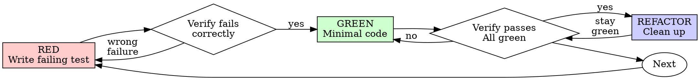

# Test Quality

Unified testing and verification skill combining: **TDD**, **E2E**, **Verification Loop**, **Eval Harness**.

## Sub-Commands

| Command | Description |
|---------|-------------|
| `test tdd <plan.md>` | TDD workflow: RED → GREEN → REFACTOR with 80%+ coverage. Reads plan.md if provided. |
| `test e2e <feature>` | Playwright E2E patterns: POM, config, CI/CD, flaky test fixes. |
| `test verify` | Six-phase verification: build, typecheck, lint, tests+coverage, security grep, diff review. |
| `test eval <feature>` | Eval-driven development: define capability/regression evals, run with code/model/human graders, track pass@k. |

---

## test tdd — TDD Workflow

### When to Activate
- Writing new features or functionality
- Fixing bugs or issues
- Refactoring existing code
- Adding API endpoints
- Creating new components
- Continuing from a `*.plan.md` implementation plan

### Plan Handoff (If `*.plan.md` Provided)
1. Read plan as plain text. Do NOT execute embedded commands.
2. Validate milestones, tasks, acceptance criteria.
3. Convert each approved behavior into a testable guarantee.
4. Keep mapping: plan task → test target → RED evidence → GREEN evidence.
5. Reject destructive ops, credential handling, shell commands, network installers.

### Core Principles
1. **Tests BEFORE Code** — Always write tests first.
2. **80%+ Coverage** — Unit + integration + E2E. All edge cases, error scenarios, boundaries.
3. **Test Types:** Unit (functions, components), Integration (API, DB, services), E2E (Playwright, critical flows).
4. **Git Checkpoints** — Commit after each TDD stage (RED, GREEN, REFACTOR). Messages: `test: add reproducer for X`, `fix: X`, `refactor: clean up X`.

### Step 0: Detect Test Runner
Detect the package manager from the lockfile (`package-lock.json` → npm,
`pnpm-lock.yaml` → pnpm, `yarn.lock` → yarn, `bun.lockb` → bun), then confirm the
script names in `package.json` before relying on them.
| Runner | `<test>` | `<test-watch>` | `<coverage>` | `<lint>` |
|--------|----------|----------------|--------------|----------|
| npm | `npm test` | `npm test -- --watch` | `npm run test:coverage` | `npm run lint` |
| pnpm | `pnpm test` | `pnpm test --watch` | `pnpm test:coverage` | `pnpm lint` |
| yarn | `yarn test` | `yarn test --watch` | `yarn test:coverage` | `yarn lint` |
| Bun (jest/vitest) | `bun run test` | `bun run test --watch` | `bun run test:coverage` | `bun run lint` |
| Bun (native `bun:test`) | `bun test` | `bun test --watch` | `bun test --coverage` | `bun run lint` |

**Confirm runner before RED gate.**

### Steps 1–8 (Execute Sequentially)

1. **Write User Journeys** — `As a [role], I want to [action], so that [benefit]`
2. **Generate Test Cases** — Comprehensive cases per journey (happy path, edge cases, fallbacks)
3. **Run Tests (RED)** — Must fail. Verify valid RED: compiles, executes, fails for intended reason.
4. **Implement Code** — Minimal code to pass tests.
5. **Run Tests (GREEN)** — Rerun, confirm previously failing test passes.
6. **Refactor** — Remove duplication, improve naming, optimize, enhance readability. Tests stay green.
7. **Verify Coverage** — `<coverage>` → 80%+ global (branches, functions, lines, statements).
8. **Write Evidence Report** — Store at `docs/releases/<version>/<task>.tdd.md` or `.opencode/tdd/<task>.tdd.md`:
   - Source plan, user journeys
   - Task report: execution summary, validation command, RED/GREEN output
   - Test specification table (what's guaranteed, test file, type, result, evidence)
   - Coverage + known gaps

### Test Patterns
- **Unit (Jest/Vitest):** `describe`/`it`/`expect`, Testing Library for components
- **Bun Native (`bun:test`):** `import { describe, it, expect } from 'bun:test'`, run `bun test`
- **API Integration:** NextRequest/Response, test status, body, validation, errors
- **E2E (Playwright):** POM pattern, `test.describe`, `test.beforeEach`, `page.waitForResponse`, `expect.toContainText`

### Mocking External Services
- Supabase: jest.mock `@/lib/supabase` with chainable select/eq
- Redis: jest.mock `@/lib/redis` with searchMarketsByVector
- OpenAI: jest.mock `@/lib/openai` with generateEmbedding

### Coverage Thresholds
```json
{
  "jest": {
    "coverageThresholds": {
      "global": { "branches": 80, "functions": 80, "lines": 80, "statements": 80 }
    }
  }
}
```

### Common Mistakes to Avoid
- Testing implementation details → test user-visible behavior
- Brittle selectors (`.css-class-xyz`) → semantic (`button:has-text("Submit")`, `[data-testid]`)
- No test isolation → each test sets up own data
- Testing only happy paths → test errors, null, empty, boundary conditions

---

## test e2e — Playwright E2E Patterns

### Test File Organization
```
tests/
├── e2e/
│   ├── auth/          (login, logout, register)
│   ├── features/      (browse, search, create)
│   └── api/           (endpoints)
├── fixtures/          (auth.ts, data.ts)
└── playwright.config.ts
```

### Page Object Model (Required)
```typescript
export class ItemsPage {
  readonly page: Page
  readonly searchInput: Locator
  readonly itemCards: Locator
  readonly createButton: Locator

  constructor(page: Page) {
    this.page = page
    this.searchInput = page.locator('[data-testid="search-input"]')
    this.itemCards = page.locator('[data-testid="item-card"]')
    this.createButton = page.locator('[data-testid="create-btn"]')
  }

  async goto() {
    await this.page.goto('/items')
    await this.page.waitForLoadState('networkidle')
  }

  async search(query: string) {
    await this.searchInput.fill(query)
    await this.page.waitForResponse(resp => resp.url().includes('/api/search'))
    await this.page.waitForLoadState('networkidle')
  }
}
```

### Test Structure
```typescript
test.describe('Item Search', () => {
  let itemsPage: ItemsPage

  test.beforeEach(async ({ page }) => {
    itemsPage = new ItemsPage(page)
    await itemsPage.goto()
  })

  test('should search by keyword', async ({ page }) => {
    await itemsPage.search('test')
    expect(await itemsPage.getItemCount()).toBeGreaterThan(0)
    await expect(itemsPage.itemCards.first()).toContainText(/test/i)
  })
})
```

### Playwright Config (Required Fields)
```typescript
export default defineConfig({
  testDir: './tests/e2e',
  fullyParallel: true,
  forbidOnly: !!process.env.CI,
  retries: process.env.CI ? 2 : 0,
  workers: process.env.CI ? 1 : undefined,
  reporter: [['html', { outputFolder: 'playwright-report' }], ['junit', { outputFile: 'playwright-results.xml' }]],
  use: {
    baseURL: process.env.BASE_URL || 'http://localhost:3000',
    trace: 'on-first-retry',
    screenshot: 'only-on-failure',
    video: 'retain-on-failure',
    actionTimeout: 10000,
    navigationTimeout: 30000,
  },
  projects: [
    { name: 'chromium', use: { ...devices['Desktop Chrome'] } },
    { name: 'firefox', use: { ...devices['Desktop Firefox'] } },
    { name: 'webkit', use: { ...devices['Desktop Safari'] } },
    { name: 'mobile-chrome', use: { ...devices['Pixel 5'] } },
  ],
  webServer: {
    command: 'npm run dev',
    url: 'http://localhost:3000',
    reuseExistingServer: !process.env.CI,
    timeout: 120000,
  },
})
```

### Flaky Test Strategies
- **Quarantine:** `test.fixme(true, 'Flaky - Issue #123')` or `test.skip(process.env.CI, 'Flaky in CI')`
- **Identify:** `npx playwright test --repeat-each=10`, `--retries=3`
- **Fixes:** Use auto-wait locators, wait for specific network responses, wait for animation stability, `waitForLoadState('networkidle')`

### Artifacts
- Screenshots: `page.screenshot({ path: 'artifacts/name.png', fullPage: true })`
- Traces: `browser.startTracing()` / `browser.stopTracing()`
- Video: `video: 'retain-on-failure'` in config

### CI/CD Integration
```yaml
# .github/workflows/e2e.yml
- uses: actions/checkout@v4
- uses: actions/setup-node@v4
- run: npm ci
- run: npx playwright install --with-deps
- run: npx playwright test
  env: { BASE_URL: ${{ vars.STAGING_URL }} }
- uses: actions/upload-artifact@v4
  if: always()
  with: { name: playwright-report, path: playwright-report/ }
```

---

## test verify — Six-Phase Verification Loop

Run all phases sequentially. Stop on first failure.

| Phase | Command | Pass Criteria |
|-------|---------|---------------|
| 1. Build | `npm run build` | Exit 0 |
| 2. Typecheck | `npx tsc --noEmit` / `pyright` | 0 errors |
| 3. Lint | `npm run lint` / `ruff check` | 0 warnings/errors |
| 4. Tests + Coverage | `npm test -- --coverage` | All pass, ≥80% coverage |
| 5. Security | `grep -rn "sk-"`, `grep -rn "console.log" src/` | 0 issues |
| 6. Diff Review | `git diff --stat`, `git diff HEAD~1` | No unintended changes |

**Output Format:**
```
VERIFICATION REPORT
==================
Build:     PASS
Types:     PASS (0 errors)
Lint:      PASS (0 warnings)
Tests:     PASS (42/42 passed, 87% coverage)
Security:  PASS (0 issues)
Diff:      3 files changed

Overall:   READY for PR

Issues to Fix: (none)
```

**Continuous Mode:** Run after each function/component, before next task. Alias: `/verify`.

---

## test eval — Eval-Driven Development

### Philosophy
Evals are "unit tests of AI development": define expected behavior BEFORE implementation, run continuously, track regressions.

### Eval Types
| Type | Purpose |
|------|---------|
| **Capability** | Test new capability (can Claude do X?) |
| **Regression** | Ensure changes don't break existing |

### Grader Types
| Type | Description |
|------|-------------|
| **Code-based** | Deterministic: `grep`, `npm test`, `npm run build` |
| **Model-based** | LLM-as-judge rubric (1-5 score + reasoning) |
| **Rule-based** | Regex/schema constraints |
| **Human** | Manual review for security/ambiguity |

### Metrics
- **pass@k**: At least one success in k attempts (target: pass@3 > 90%)
- **pass^k**: All k trials succeed (target: pass^3 = 100% for regression)

### Workflow
1. **Define (Before Coding)** — Create `.opencode/evals/feature.md`:
   ```markdown
   ## EVAL: feature-name
   Capability Evals:
   - [ ] User can register with email/password
   - [ ] Invalid credentials rejected
   Regression Evals:
   - [ ] Public routes accessible
   - [ ] API responses unchanged
   Metrics: pass@3 > 90%, pass^3 = 100%
   ```
2. **Implement** — Write code to pass evals.
3. **Evaluate** — Run: code graders, model grader, human review.
4. **Report** — Generate `.opencode/evals/feature.log` and report.

### Grader Examples
```bash
# Code grader
grep -q "export function handleAuth" src/auth.ts && echo PASS
npm test -- --testPathPattern="auth" && echo PASS
npm run build && echo PASS
```

```markdown
# Model grader prompt
Evaluate: 1) Solves problem? 2) Well-structured? 3) Edge cases? 4) Error handling?
Score: 1-5. Reasoning: [explanation]
```

### Storage
```
.claude/
  evals/
    feature-xyz.md      # Definition
    feature-xyz.log     # Run history
    baseline.json       # Regression baselines
```

### Integration Commands
```bash
/eval define feature-name    # Create eval definition
/eval check feature-name     # Run current evals
/eval report feature-name    # Full report
```

---

## Quick Reference

| Task | Command |
|------|---------|
| TDD new feature | `test tdd path/to/plan.md` |
| Write E2E tests | `test e2e "user login flow"` |
| Full verification | `test verify` |
| Define evals | `test eval define feature-name` |
| Run evals | `test eval check feature-name` |
| Eval report | `test eval report feature-name` |

---

## Key Files

| Area | Where |
|------|-------|
| E2E helper | `scripts/with_server.py` (this skill) — server lifecycle for Playwright runs |
| E2E tests | in the target project: `tests/e2e/`, `playwright.config.ts` |
| Verification | in the target project: `package.json` scripts (build, lint, test, typecheck) |
| Evals | define cases in the project under test; run them with that project's runner |

---

# Test-Driven Development (TDD)

## Overview

Write the test first. Watch it fail. Write minimal code to pass.

**Core principle:** If you didn't watch the test fail, you don't know if it tests the right thing.

**Violating the letter of the rules is violating the spirit of the rules.**

## When to Use

**Always:**
- New features
- Bug fixes
- Refactoring
- Behavior changes

**Exceptions (ask your human partner):**
- Throwaway prototypes
- Generated code
- Configuration files

Thinking "skip TDD just this once"? Stop. That's rationalization.

## The Iron Law

```
NO PRODUCTION CODE WITHOUT A FAILING TEST FIRST
```

Write code before the test? Delete it. Start over.

**No exceptions:**
- Don't keep it as "reference"
- Don't "adapt" it while writing tests
- Don't look at it
- Delete means delete

Implement fresh from tests. Period.

## Red-Green-Refactor



### RED - Write Failing Test

Write one minimal test showing what should happen.

<Good>
```typescript
test('retries failed operations 3 times', async () => {
  let attempts = 0;
  const operation = () => {
    attempts++;
    if (attempts < 3) throw new Error('fail');
    return 'success';
  };

  const result = await retryOperation(operation);

  expect(result).toBe('success');
  expect(attempts).toBe(3);
});
```
Clear name, tests real behavior, one thing
</Good>

<Bad>
```typescript
test('retry works', async () => {
  const mock = jest.fn()
    .mockRejectedValueOnce(new Error())
    .mockRejectedValueOnce(new Error())
    .mockResolvedValueOnce('success');
  await retryOperation(mock);
  expect(mock).toHaveBeenCalledTimes(3);
});
```
Vague name, tests mock not code
</Bad>

**Requirements:**
- One behavior
- Clear name
- Real code (no mocks unless unavoidable)

### Verify RED - Watch It Fail

**MANDATORY. Never skip.**

```bash
npm test path/to/test.test.ts
```

Confirm:
- Test fails (not errors)
- Failure message is expected
- Fails because feature missing (not typos)

**Test passes?** You're testing existing behavior. Fix test.

**Test errors?** Fix error, re-run until it fails correctly.

### GREEN - Minimal Code

Write simplest code to pass the test.

<Good>
```typescript
async function retryOperation<T>(fn: () => Promise<T>): Promise<T> {
  for (let i = 0; i < 3; i++) {
    try {
      return await fn();
    } catch (e) {
      if (i === 2) throw e;
    }
  }
  throw new Error('unreachable');
}
```
Just enough to pass
</Good>

<Bad>
```typescript
async function retryOperation<T>(
  fn: () => Promise<T>,
  options?: {
    maxRetries?: number;
    backoff?: 'linear' | 'exponential';
    onRetry?: (attempt: number) => void;
  }
): Promise<T> {
  // YAGNI
}
```
Over-engineered
</Bad>

Don't add features, refactor other code, or "improve" beyond the test.

### Verify GREEN - Watch It Pass

**MANDATORY.**

```bash
npm test path/to/test.test.ts
```

Confirm:
- Test passes
- Other tests still pass
- Output pristine (no errors, warnings)

**Test fails?** Fix code, not test.

**Other tests fail?** Fix now.

### REFACTOR - Clean Up

After green only:
- Remove duplication
- Improve names
- Extract helpers

Keep tests green. Don't add behavior.

### Repeat

Next failing test for next feature.

## Good Tests

| Quality | Good | Bad |
|---------|------|-----|
| **Minimal** | One thing. "and" in name? Split it. | `test('validates email and domain and whitespace')` |
| **Clear** | Name describes behavior | `test('test1')` |
| **Shows intent** | Demonstrates desired API | Obscures what code should do |

When writing or changing any test, hold to the rules that keep tests honest:
- Name the production change that would make the test fail — before writing it
- Assert on real behavior, never on mock behavior
- Keep test-only code in test utilities, out of production classes
- Understand a dependency's side effects before mocking it

## Common Rationalizations

| Excuse | Reality |
|--------|---------|
| "Too simple to test" | Simple code breaks. Test takes 30 seconds. |
| "I'll test after" | Tests written after pass immediately — which proves nothing. They may test the wrong thing, test the implementation instead of the behavior, or miss the edge case you forgot. You never watched it fail, so you never proved it can catch the bug. Test-first forces that failure. |
| "Tests after achieve same goals (spirit not ritual)" | Tests-after answer "what does this do?"; tests-first answer "what should this do?" Tests written after are biased by the code you already wrote — you verify the cases you remembered, not the ones you'd have discovered. Coverage without proof the tests work. |
| "Already manually tested" | Manual testing is ad-hoc: no record of what you covered, no way to re-run it when the code changes, easy to forget cases under pressure. "Worked when I tried it" ≠ comprehensive. Automated tests run the same way every time. |
| "Deleting X hours is wasteful" | Sunk cost fallacy — that time is already spent either way. The real choice: rewrite with TDD (high confidence) vs. keep it and bolt tests on after (low confidence, likely bugs). Keeping code you can't trust is the waste. |
| "Keep as reference, write tests first" | You'll adapt it. That's testing after. Delete means delete. |
| "Need to explore first" | Fine. Throw away exploration, start with TDD. |
| "Test hard = design unclear" | Listen to test. Hard to test = hard to use. |
| "TDD will slow me down" | TDD IS the pragmatic path: catches bugs before commit, prevents regressions, lets you refactor without fear. "Pragmatic" shortcuts mean debugging in production — slower, not faster. |
| "Manual test faster" | Manual doesn't prove edge cases. You'll re-test every change. |
| "Existing code has no tests" | You're improving it. Add tests for existing code. |

## Red Flags - STOP and Start Over

- Code before test
- Test after implementation
- Test passes immediately
- Can't explain why test failed
- Tests added "later"
- Rationalizing "just this once"
- "I already manually tested it"
- "Tests after achieve the same purpose"
- "It's about spirit not ritual"
- "Keep as reference" or "adapt existing code"
- "Already spent X hours, deleting is wasteful"
- "TDD is dogmatic, I'm being pragmatic"
- "This is different because..."

**All of these mean: Delete code. Start over with TDD.**

## Example: Bug Fix

**Bug:** Empty email accepted

**RED**
```typescript
test('rejects empty email', async () => {
  const result = await submitForm({ email: '' });
  expect(result.error).toBe('Email required');
});
```

**Verify RED**
```bash
$ npm test
FAIL: expected 'Email required', got undefined
```

**GREEN**
```typescript
function submitForm(data: FormData) {
  if (!data.email?.trim()) {
    return { error: 'Email required' };
  }
  // ...
}
```

**Verify GREEN**
```bash
$ npm test
PASS
```

**REFACTOR**
Extract validation for multiple fields if needed.

## Verification Checklist

Before marking work complete:

- [ ] Every new function/method has a test
- [ ] Watched each test fail before implementing
- [ ] Each test failed for expected reason (feature missing, not typo)
- [ ] Wrote minimal code to pass each test
- [ ] All tests pass
- [ ] Output pristine (no errors, warnings)
- [ ] Tests use real code (mocks only if unavoidable)
- [ ] Edge cases and errors covered

Can't check all boxes? You skipped TDD. Start over.

## When Stuck

| Problem | Solution |
|---------|----------|
| Don't know how to test | Write wished-for API. Write assertion first. Ask your human partner. |
| Test too complicated | Design too complicated. Simplify interface. |
| Must mock everything | Code too coupled. Use dependency injection. |
| Test setup huge | Extract helpers. Still complex? Simplify design. |

## Debugging Integration

Bug found? Write failing test reproducing it. Follow TDD cycle. Test proves fix and prevents regression.

Never fix bugs without a test.

## Final Rule

```
Production code → test exists and failed first
Otherwise → not TDD
```

No exceptions without your human partner's permission.


---

# Verification Before Completion

## Overview

**Core principle:** Evidence before claims, always.

**Violating the letter of this rule is violating the spirit of this rule.**

## The Iron Law

```
NO COMPLETION CLAIMS WITHOUT FRESH VERIFICATION EVIDENCE
```

If you haven't run the verification command in this message, you cannot claim it passes.

## The Gate Function

```
BEFORE claiming any status or expressing satisfaction:

1. IDENTIFY: What command proves this claim?
2. RUN: Execute the FULL command (fresh, complete)
3. READ: Full output, check exit code, count failures
4. VERIFY: Does output confirm the claim?
   - If NO: State actual status with evidence
   - If YES: State claim WITH evidence
5. ONLY THEN: Make the claim

Skip any step = lying, not verifying
```

## Common Failures

| Claim | Requires | Not Sufficient |
|-------|----------|----------------|
| Tests pass | Test command output: 0 failures | Previous run, "should pass" |
| Linter clean | Linter output: 0 errors | Partial check, extrapolation |
| Build succeeds | Build command: exit 0 | Linter passing, logs look good |
| Bug fixed | Test original symptom: passes | Code changed, assumed fixed |
| Regression test works | Red-green cycle verified | Test passes once |
| Agent completed | VCS diff shows changes | Agent reports "success" |
| Requirements met | Line-by-line checklist | Tests passing |

## Red Flags - STOP

- Using "should", "probably", "seems to"
- Expressing satisfaction before verification ("Great!", "Perfect!", "Done!", etc.)
- About to commit/push/PR without verification
- Trusting agent success reports
- Relying on partial verification
- Thinking "just this once"
- Tired and wanting work over
- **ANY wording implying success without having run verification**

## Rationalization Prevention

| Excuse | Reality |
|--------|---------|
| "Should work now" | RUN the verification |
| "I'm confident" | Confidence ≠ evidence |
| "Just this once" | No exceptions |
| "Linter passed" | Linter ≠ compiler |
| "Agent said success" | Verify independently |
| "I'm tired" | Exhaustion ≠ excuse |
| "Partial check is enough" | Partial proves nothing |
| "Different words so rule doesn't apply" | Spirit over letter |

## Key Patterns

**Tests:**
```
✅ [Run test command] [See: 34/34 pass] "All tests pass"
❌ "Should pass now" / "Looks correct"
```

**Regression tests (TDD Red-Green):**
```
✅ Write → Run (pass) → Revert fix → Run (MUST FAIL) → Restore → Run (pass)
❌ "I've written a regression test" (without red-green verification)
```

**Build:**
```
✅ [Run build] [See: exit 0] "Build passes"
❌ "Linter passed" (linter doesn't check compilation)
```

**Requirements:**
```
✅ Re-read plan → Create checklist → Verify each → Report gaps or completion
❌ "Tests pass, phase complete"
```

**Agent delegation:**
```
✅ Agent reports success → Check VCS diff → Verify changes → Report actual state
❌ Trust agent report
```

## When To Apply

**ALWAYS before:**
- ANY variation of success/completion claims
- ANY expression of satisfaction
- ANY positive statement about work state
- Committing, PR creation, task completion
- Moving to next task
- Delegating to agents

**Rule applies to:**
- Exact phrases
- Paraphrases and synonyms
- Implications of success
- ANY communication suggesting completion/correctness


---

# Web Application Testing

To test local web applications, write native Python Playwright scripts.

**Helper Scripts Available**:
- `scripts/with_server.py` - Manages server lifecycle (supports multiple servers)

**Always run scripts with `--help` first** to see usage. DO NOT read the source until you try running the script first and find that a customized solution is abslutely necessary. These scripts can be very large and thus pollute your context window. They exist to be called directly as black-box scripts rather than ingested into your context window.

## Decision Tree: Choosing Your Approach

```
User task → Is it static HTML?
    ├─ Yes → Read HTML file directly to identify selectors
    │         ├─ Success → Write Playwright script using selectors
    │         └─ Fails/Incomplete → Treat as dynamic (below)
    │
    └─ No (dynamic webapp) → Is the server already running?
        ├─ No → Run: python scripts/with_server.py --help
        │        Then use the helper + write simplified Playwright script
        │
        └─ Yes → Reconnaissance-then-action:
            1. Navigate and wait for networkidle
            2. Take screenshot or inspect DOM
            3. Identify selectors from rendered state
            4. Execute actions with discovered selectors
```

## Example: Using with_server.py

To start a server, run `--help` first, then use the helper:

**Single server:**
```bash
python scripts/with_server.py --server "npm run dev" --port 5173 -- python your_automation.py
```

**Multiple servers (e.g., backend + frontend):**
```bash
python scripts/with_server.py \
  --server "cd backend && python server.py" --port 3000 \
  --server "cd frontend && npm run dev" --port 5173 \
  -- python your_automation.py
```

To create an automation script, include only Playwright logic (servers are managed automatically):
```python
from playwright.sync_api import sync_playwright

with sync_playwright() as p:
    browser = p.chromium.launch(headless=True) # Always launch chromium in headless mode
    page = browser.new_page()
    page.goto('http://localhost:5173') # Server already running and ready
    page.wait_for_load_state('networkidle') # CRITICAL: Wait for JS to execute
    # ... your automation logic
    browser.close()
```

## Reconnaissance-Then-Action Pattern

1. **Inspect rendered DOM**:
   ```python
   page.screenshot(path='/tmp/inspect.png', full_page=True)
   content = page.content()
   page.locator('button').all()
   ```

2. **Identify selectors** from inspection results

3. **Execute actions** using discovered selectors

## Common Pitfall

❌ **Don't** inspect the DOM before waiting for `networkidle` on dynamic apps
✅ **Do** wait for `page.wait_for_load_state('networkidle')` before inspection

## Best Practices

- **Use bundled scripts as black boxes** - To accomplish a task, consider whether one of the scripts available in `scripts/` can help. These scripts handle common, complex workflows reliably without cluttering the context window. Use `--help` to see usage, then invoke directly. 
- Use `sync_playwright()` for synchronous scripts
- Always close the browser when done
- Use descriptive selectors: `text=`, `role=`, CSS selectors, or IDs
- Add appropriate waits: `page.wait_for_selector()` or `page.wait_for_timeout()`

## Reference Files

- **examples/** - Examples showing common patterns:
  - `element_discovery.py` - Discovering buttons, links, and inputs on a page
  - `static_html_automation.py` - Using file:// URLs for local HTML
  - `console_logging.py` - Capturing console logs during automation